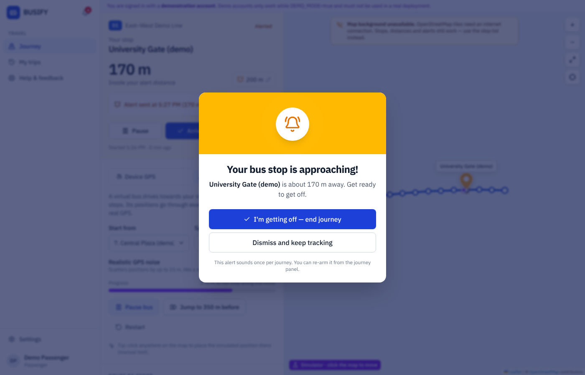
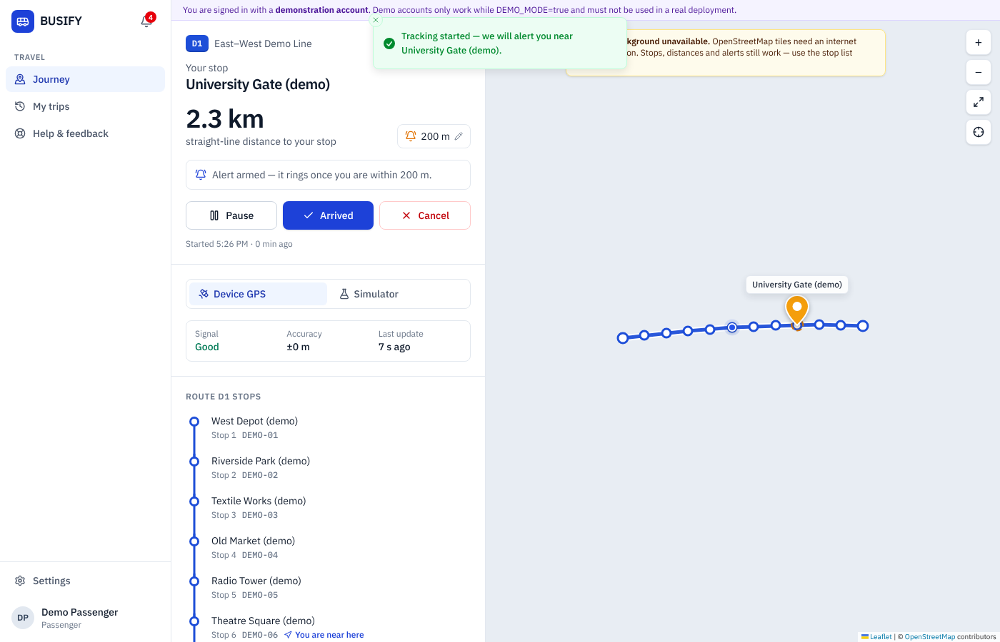
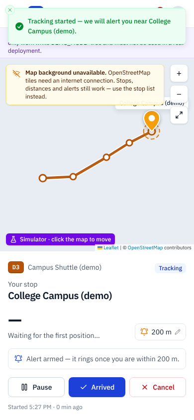
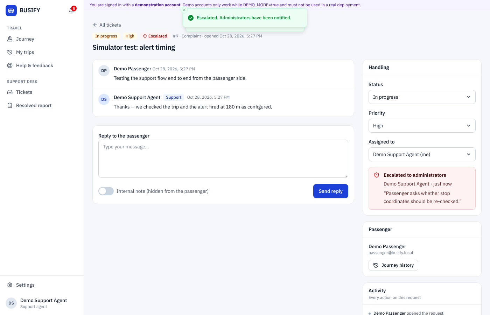
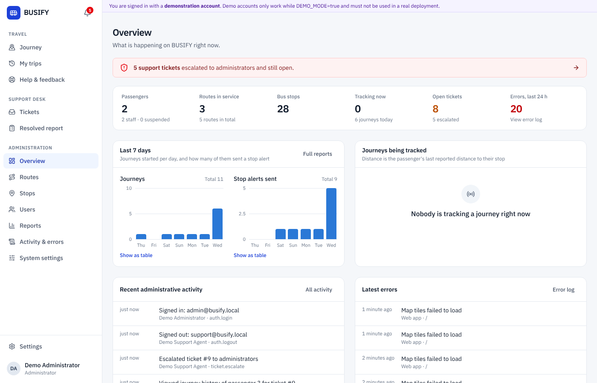
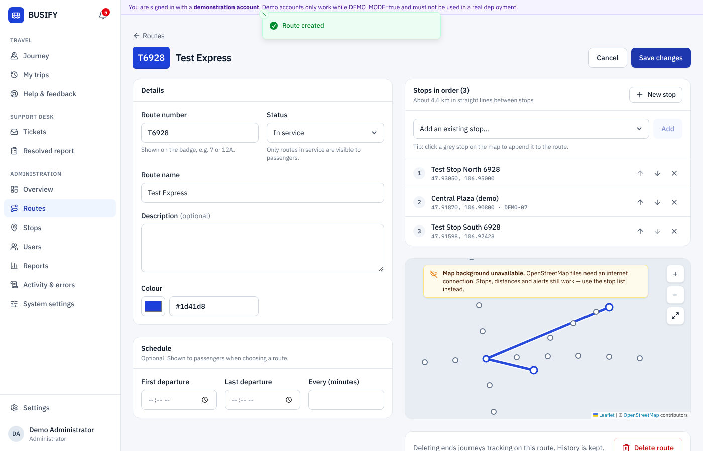
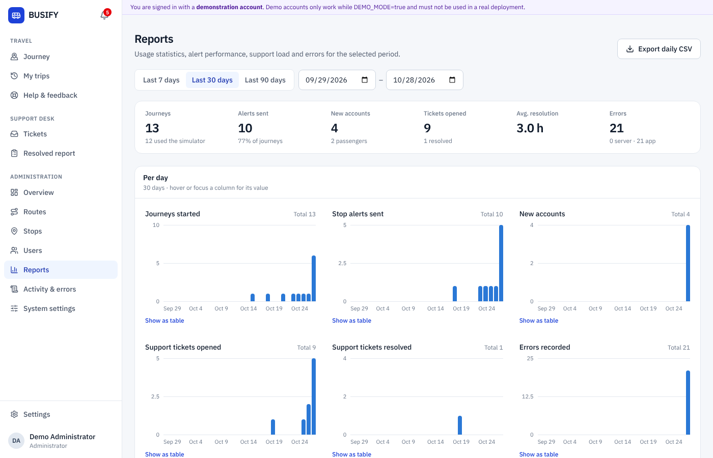

# BUSIFY — Bus stop alert system

BUSIFY wakes passengers up before their stop. A passenger picks a route and the stop
where they want to get off. BUSIFY then follows their **real GPS position** and sounds
an alarm, vibrates and shows **"Your bus stop is approaching!"** once they are within
the chosen distance (200 m by default). It does not guess with a timer.

It runs entirely on your own computer and local network: a React web app, an
Express REST API and a SQLite database. There is no cloud hosting and no external
backend. The only optional outside resource is the OpenStreetMap map background.

Built for the *Системийн шинжилгээ ба зохиомж* project of team 6 (New Mongolia Technology
College). The roles and use cases follow the team's requirements document and diagrams.

| Role | What they do |
|---|---|
| **Passenger** | Register, allow location, choose route and stop, set the alert distance, receive sound/vibration alerts, view trips, contact support |
| **Support agent** | Receive complaints and feedback, reply, keep internal notes, view the complaining passenger's journey history, escalate to an administrator, produce the resolved-cases report |
| **Administrator** | Manage routes (with schedule and stop order), stops (coordinates on a map), users and roles, system settings, statistics, error reports and the audit log |



| Journey tracking | Phone | Support ticket |
|---|---|---|
|  |  |  |
| **Admin overview** | **Route editor** | **Reports** |
|  |  |  |

*The screenshots were taken on a machine without internet access, so the OpenStreetMap
background is replaced by BUSIFY's "map background unavailable" notice. The stops, the route
and the alerts still work.*

---

## Contents

1. [Quick start on Windows 11](#quick-start-on-windows-11)
2. [Demonstration accounts](#demonstration-accounts-local-development-only)
3. [Test the stop alert](#test-the-stop-alert)
4. [Use BUSIFY from your phone (local Wi-Fi)](#use-busify-from-your-phone-local-wi-fi)
5. [Configuration (`.env`)](#configuration-env)
6. [Commands](#commands)
7. [Database](#database)
8. [Tests](#tests)
9. [How it works](#how-it-works)
10. [Project structure](#project-structure)
11. [Implemented features](#implemented-features)
12. [Limitations](#limitations)
13. [Troubleshooting](#troubleshooting)

API reference: **[docs/API.md](docs/API.md)** · Database and ER diagram: **[docs/DATABASE.md](docs/DATABASE.md)**

---

## Quick start on Windows 11

### 1. Install the prerequisites

* **Node.js 22 LTS** from <https://nodejs.org> (Node 20.19+ also works). Keep the default
  options. Afterwards `node -v` in PowerShell should print `v22…`.
* Optional: **Git** from <https://git-scm.com> to clone the repository. You can also download it as a ZIP and unzip it.

### 2. Install and set up

Double-click **`setup.bat`** in the project folder. It installs the dependencies, creates
your `.env`, creates and migrates the SQLite database, and loads the demonstration data.

Or do the same in PowerShell:

```bash
npm install
```

```bash
npm run setup
```

`npm run setup` is safe to run again; it never overwrites an existing `.env` or your data.

### 3. Start BUSIFY

Double-click **`start-busify.bat`**, or run:

```bash
npm run dev
```

Open **<http://localhost:5173>** and sign in with a [demo account](#demonstration-accounts-local-development-only).
Leave the window open while you use BUSIFY. Press **Ctrl+C** to stop it.

`npm run dev` starts two local servers: the Express API on port 4000 and the Vite
development server on port 5173. Vite forwards `/api` to the API.

---

## Demonstration accounts (local development only)

`npm run setup` (via `npm run db:seed:demo`) creates these accounts when `DEMO_MODE=true`:

| Role | Email | Password |
|---|---|---|
| Administrator | `admin@busify.local` | `BusifyDemo2026` |
| Support agent | `support@busify.local` | `BusifyDemo2026` |
| Passenger | `passenger@busify.local` | `BusifyDemo2026` |
| Passenger | `rider@busify.local` | `BusifyDemo2026` |

The password comes from `DEMO_ACCOUNT_PASSWORD` in `.env`. Re-running `npm run db:seed:demo`
applies a changed value.

**These credentials are for classroom demonstrations only.** They are protected as follows:

* Demo accounts are flagged in the database. When `DEMO_MODE` is `false` or missing, the
  server **refuses to sign them in**, ends their existing sessions and will not run the demo
  seed. A banner reminds you whenever a demo account is signed in.
* For any real use, set `DEMO_MODE=false` and create your own administrator:

  ```bash
  npm run create-admin
  ```

* Remove all demonstration data (demo accounts and the invented routes and stops) with:

  ```bash
  npm run db:remove-demo
  ```

### About the sample routes

The demo routes **D1, D2, D3** (in service), **D4** (suspended) and **D9** (draft) and their
23 stops are **invented**. Their coordinates are scattered around central Ulaanbaatar only so
the map looks sensible. They are **not real bus routes or stop positions**, and every one is
labelled "(demo)" in the app. Enter real routes and coordinates in **Admin → Stops** and
**Admin → Routes**. The seed also adds a little sample history (trips and tickets) so the
dashboards are not empty.

---

## Test the stop alert

### With the simulator (no travelling needed, works on any computer)

1. Sign in as `passenger@busify.local`.
2. Choose **D1 East–West Demo Line**, then the stop **University Gate (demo)**, and press **Start journey**.
3. In the journey panel open the **Simulator** tab.
4. Press **Jump to 350 m before**, then **Start driving**. A virtual bus drives along the
   route; the distance counts down.
5. At about 200 m the alert appears with sound (and vibration on phones that support it).
   Press **Dismiss and keep tracking**: the bus continues past the stop and the alert
   **does not repeat**. Reload the page: it still does not repeat. **Re-arm alert** enables
   it once more.
6. You can also click anywhere on the map to place the simulated position by hand.

The simulator's positions go through **exactly the same alert logic** as real GPS readings.
Its optional "GPS noise" scatters positions by up to 15 m to show that fluctuation does not
cause duplicate alerts.

### With real GPS

* On the computer itself, `http://localhost:5173` counts as a secure page, so the browser
  will ask for location permission.
* On a phone you need HTTPS. See [the next section](#use-busify-from-your-phone-local-wi-fi).
* Keep the screen on during the ride (BUSIFY requests a screen wake lock where supported).
  Browsers pause GPS and timers for background tabs and locked screens. This depends on the
  browser and device and cannot be bypassed by a web page.

---

## Use BUSIFY from your phone (local Wi-Fi)

The phone and the computer must be on the **same Wi-Fi network**.

### 1. Start BUSIFY for the network

```bash
npm run lan -- --https
```

(or double-click **`start-lan-https.bat`**). This builds the app and serves everything from
**one port (4000)** on all network interfaces, with a self-signed HTTPS certificate.
`npm run lan` without `--https` serves plain HTTP. That is fine for the simulator, but phones
block GPS on non-secure pages.

Your `.env` is not changed: `HOST` is set to `0.0.0.0` for this run only. To make it
permanent, set `HOST=0.0.0.0` (or one specific LAN address) in `.env`.

### 2. Find the computer's address

The server prints the addresses when it starts. You can also run:

```bash
npm run lan-info
```

Or in PowerShell run `ipconfig` and look for **IPv4 Address** under your *Wi-Fi* adapter,
for example `192.168.1.20`.

### 3. Open it on the phone

Go to `https://192.168.1.20:4000` (use your address). The phone warns that the certificate
is not trusted, because it was generated by your own computer. Choose *Advanced → Proceed*
once. Then allow location when BUSIFY asks.

> On a phone, `localhost` means the phone itself, never your computer. That is why the
> frontend calls the API with the relative URL `/api` (`VITE_API_BASE_URL`): the requests go
> back to whichever computer served the page.

### Windows Firewall

The first time Node.js listens on the network, Windows asks *"Allow Node.js JavaScript
Runtime to communicate on these networks?"*. Tick **Private networks** only, and click
**Allow**. If you dismissed it, or the phone cannot connect:

1. Make sure your Wi-Fi is set to **Private**: *Settings → Network & internet → Wi-Fi →
   (your network) → Network profile type → Private network*.
2. Allow the port in an **administrator** PowerShell:

   ```bash
   New-NetFirewallRule -DisplayName "BUSIFY 4000" -Direction Inbound -Protocol TCP -LocalPort 4000 -Action Allow -Profile Private
   ```

   To remove it later: `Remove-NetFirewallRule -DisplayName "BUSIFY 4000"`.

### Keep it local

* `HOST=127.0.0.1` (the default) accepts connections from this computer only.
* `LAN_ONLY=true` (the default) also rejects any request from a non-private IP address, as a
  second safety net.
* **Do not** set up port forwarding on your router. BUSIFY is a local demonstration system
  and should not be exposed to the internet.

---

## Configuration (`.env`)

All settings live in one `.env` file in the project root, used by both the server and the
web app. `npm run setup` creates it from [`.env.example`](.env.example), which documents
every value. The most important ones:

| Variable | Default | Meaning |
|---|---|---|
| `HOST` | `127.0.0.1` | Interface to listen on. `0.0.0.0` = whole LAN. |
| `PORT` | `4000` | API (and built app) port. |
| `LAN_ONLY` | `true` | Reject requests from public IP addresses. |
| `DATABASE_URL` | `file:../data/busify.db` | SQLite file (relative to `server/prisma`). |
| `DEMO_MODE` | `true` in the example, `false` if missing | Allow demo accounts and the demo seed. |
| `DEMO_ACCOUNT_PASSWORD` | `BusifyDemo2026` | Password for the demo accounts. |
| `SESSION_TTL_HOURS` | `168` | How long a sign-in lasts. |
| `BCRYPT_ROUNDS` | `12` | Password hashing cost. |
| `AUTH_RATE_LIMIT` | `30` | Sign-in attempts per IP per 15 minutes. |
| `HTTPS_ENABLED` | `false` | Serve HTTPS (self-signed certificate in `server/certs/` unless `HTTPS_CERT_FILE`/`HTTPS_KEY_FILE` are set). |
| `COOKIE_SECURE` | `auto` | Secure cookies when HTTPS is on. |
| `CORS_ORIGINS` | – | Extra allowed origins, only if the frontend is hosted elsewhere. |
| `VITE_API_BASE_URL` | `/api` | API URL used by the browser. Keep it relative. |
| `VITE_MAP_TILE_URL` | OpenStreetMap | Tile server template; point it at a local tile server for offline maps. |
| `VITE_MAP_DEFAULT_CENTER` / `_ZOOM` | Ulaanbaatar, 13 | Map view before a location is known. |
| `CLIENT_DEV_HOST` / `CLIENT_DEV_PORT` | `127.0.0.1` / `5173` | Vite dev server. |

No secret is hard-coded. Sessions use random tokens, so no signing secret is needed.
If `.env` or `DATABASE_URL` is missing, the server stops with a clear message telling you
to run `npm run setup`.

Settings that administrators change while BUSIFY runs are stored in the database, not in
`.env`: alert distance limits, GPS accuracy filter, registration on/off and the
announcement banner. They live under **Admin → System settings**.

---

## Commands

Run from the project root:

| Command | What it does |
|---|---|
| `npm install` | Install all dependencies (workspaces: `shared`, `server`, `client`). |
| `npm run setup` | Create `.env`, migrate the database, seed roles/settings and (if `DEMO_MODE=true`) demo data. Add `-- --no-demo` to skip demo data. |
| `npm run dev` | Start API (port 4000, auto-restart) and web app (port 5173, hot reload). |
| `npm run build` | Build the web app (`client/dist`) and the server (`server/dist`). |
| `npm start` | Run the built server; it also serves the built web app on port 4000. |
| `npm run lan` | Build and serve on the local network (`-- --https` for HTTPS, `-- --no-build` to skip building). |
| `npm run lan-info` | Show this computer's LAN addresses and phone URLs. |
| `npm test` | Run all tests. |
| `npm run typecheck` | Type-check every package. |
| `npm run db:migrate` | Apply database migrations. |
| `npm run db:seed` | Create/refresh roles, permissions and default settings (no accounts, no routes). |
| `npm run db:seed:demo` | Add demonstration data (requires `DEMO_MODE=true`). |
| `npm run db:remove-demo` | Delete demo accounts, routes and stops. |
| `npm run db:reset` | **Erase the database** and re-create it with demo data. |
| `npm run db:studio` | Browse the database in Prisma Studio. |
| `npm run create-admin` | Create or promote a real administrator. |

Windows shortcuts: `setup.bat`, `start-busify.bat`, `start-lan.bat`, `start-lan-https.bat`.

---

## Database

* **Engine:** SQLite, through Prisma ORM. All queries are parameterised by Prisma.
* **File:** `server/data/busify.db` (git-ignored). **Back up** by copying it while BUSIFY is stopped.
* **Schema:** [`server/prisma/schema.prisma`](server/prisma/schema.prisma).
  **Migrations:** `server/prisma/migrations/`.
* **ER diagram and table reference:** [`docs/DATABASE.md`](docs/DATABASE.md).
* **Browse data:** `npm run db:studio`, then open the URL it prints.

| Table | Purpose |
|---|---|
| `User`, `Role`, `Permission`, `RolePermission` | Accounts (bcrypt hashes), roles and their permissions |
| `Session` | Server-side sign-in sessions (only the token hash is stored) |
| `UserSettings` | Alert distance, sound, vibration, notifications, wake lock |
| `Route`, `Stop`, `RouteStop` | Routes with schedule, stops with coordinates, ordered membership |
| `Journey` | Passenger alert sessions (status, alert state, last distance — no raw coordinates) |
| `SupportTicket`, `SupportResponse`, `TicketEvent` | Complaints and feedback, replies and internal notes, action timeline |
| `Notification` | In-app notifications (e.g. escalations to admins, replies to passengers) |
| `AuditLog` | Administrative and support actions |
| `ErrorLog` | Server errors and problems reported by browsers |
| `SystemSetting` | Settings administrators change at runtime |

Required reference data (`npm run db:seed`) and demonstration data (`npm run db:seed:demo`)
are kept apart. Demo rows are flagged (`isDemo`, `isDemoAccount`) so `npm run db:remove-demo`
can delete them without touching real data.

To change the schema, edit `schema.prisma`, then run `npm run db:migrate:dev -w server -- --name your_change`.

---

## Tests

```bash
npm test
```

| Suite | Location | Covers |
|---|---|---|
| Distance & alert engine | `shared/src/*.test.ts` | Haversine accuracy, coordinate validation, radius handling, fluctuation around the radius, inaccurate/out-of-order readings, once-per-journey, re-arm hysteresis, restore after refresh; route/stop validation schemas |
| Simulator | `client/src/features/journey/simulator.test.ts` | Simulated path, GPS noise, and a full simulated trip through the alert engine at three speeds that must alert exactly once, before the stop |
| API | `server/tests/*.test.ts` | Registration/login/logout, hashing, role injection, forced password change, CSRF header, permissions for every role, last-admin safeguards, route/stop validation and ordering, journey rules (one active journey, idempotent alerts), support ticket scoping, escalation, reports, startup errors for a missing `DATABASE_URL` or an unmigrated database |

API tests use their own database file (`server/data/test.db`) and never touch your data.

---

## How it works

```
 Phone / PC browser                         Your computer
┌──────────────────────────────┐    HTTP(S)  ┌───────────────────────────────────┐
│ React app (client/)          │  /api/...   │ Express API (server/)             │
│  • Leaflet map (OSM tiles)───┼──internet──▶│  • session cookies, RBAC, zod     │
│  • GPS watch / simulator     │◀───────────▶│  • routes, stops, journeys,       │
│  • alert engine (shared/)    │             │    support, admin, reports        │
│  • sound, vibration, notif.  │             │  • Prisma ──▶ SQLite busify.db    │
└──────────────────────────────┘             └───────────────────────────────────┘
```

**Alert logic** ([`shared/src/alertEngine.ts`](shared/src/alertEngine.ts)) is a pure function
run on every position reading:

1. The distance to the destination stop is calculated with the haversine formula.
2. Readings less accurate than the configured limit (default ±150 m) are ignored, as are
   readings that arrive out of order.
3. A reading that is **certainly** inside the radius (distance + accuracy ≤ radius) fires
   immediately. A reading only **possibly** inside needs 2 consecutive inside readings, so
   one jittery fix at the edge does not set it off.
4. Once fired, the alert never fires again for that journey. The server records it
   atomically (`POST /journeys/:id/alert` is idempotent), so even a page refresh, a second
   tab or GPS fluctuation cannot repeat it.
5. **Re-arm alert** works with hysteresis: if you are still near the stop, it waits until
   you are clearly outside (radius + 25 %, at least 30 m) before it can fire again.

The alert itself plays a Web Audio chime, vibrates (`navigator.vibrate`), shows a
full-screen dialog, flashes the tab title and, if permitted, shows a system notification
through a small service worker (`client/public/sw.js`).

**Security summary**

* bcrypt password hashes, never returned by the API.
* Random session tokens in httpOnly `SameSite=Strict` cookies; only their hash is stored.
* A CSRF header is required on writes.
* Permissions are loaded from the database on every request, and client-sent roles are ignored.
* zod validation on every body and query, a rate limit on sign-in, and Helmet security
  headers (including a Content-Security-Policy).
* LAN-only access guard, and an audit log for administrative and support actions.

---

## Project structure

```
busify/
├─ shared/            geo maths, alert engine, constants, zod schemas (+ unit tests)
├─ server/
│  ├─ prisma/         schema.prisma, migrations/, seed.ts, seed-demo.ts, demo-data.ts
│  ├─ src/
│  │  ├─ config/      .env loading and validation
│  │  ├─ lib/         prisma, sessions, passwords, audit, errors, settings, TLS…
│  │  ├─ middleware/  auth & permissions, CSRF, LAN-only, errors, request log
│  │  ├─ routes/      REST endpoints (auth, me, routes, stops, journeys, support, admin…)
│  │  ├─ services/    route and journey helpers
│  │  └─ scripts/     create-admin, remove-demo
│  └─ tests/          API tests (vitest + supertest)
├─ client/
│  ├─ public/         favicon, notification service worker
│  └─ src/
│     ├─ components/  UI kit (ui/), map, charts, layout
│     ├─ features/    auth, journey tracking (provider, GPS, simulator, alert effects)
│     ├─ pages/       auth, passenger, support, desk, admin
│     └─ lib/         API client, types, formatting
├─ scripts/           setup, LAN launcher, LAN info
├─ docs/API.md        REST API reference
├─ docs/DATABASE.md   ER diagram and table reference
├─ docs/diagrams/     ER diagram (SVG/PNG, Mermaid source, generator)
└─ *.bat              Windows shortcuts
```

---

## Implemented features

**Passenger**
- [x] Register, sign in and sign out (bcrypt, server-side sessions), with validation and clear errors
- [x] Protected pages; a forced password change after an admin reset
- [x] Dashboard with an interactive map, your position, nearby stops and routes in service
- [x] Search routes by number or name, and stops by name (works with Cyrillic)
- [x] Stops in route order as a line diagram; choose the destination from the list or the map
- [x] Alert distance (default 200 m) set per journey and in settings
- [x] GPS tracking of the active journey, distance remaining, accuracy and last update
- [x] "Your bus stop is approaching!" alert with sound, vibration, system notification and tab title, once per journey
- [x] Start, pause, resume, cancel (with confirmation), arrived, re-arm alert
- [x] Handles denied permission, insecure pages, unsupported browsers, temporary GPS loss, stale fixes and low accuracy
- [x] One running journey per passenger, enforced by the server
- [x] Route simulator and manual map positioning for testing without travelling
- [x] Screen wake lock, background-tracking explanation, refresh-safe tracking
- [x] Trip history; settings for sound, vibration, notifications and screen; a location permission helper; profile; password change

**Administrator**
- [x] Overview: passengers, routes, stops, live journeys, open and escalated tickets, errors, 7-day charts, recent activity
- [x] Routes: create, edit, delete (with confirmation); number, name, description, status, colour, schedule; ordered stops (add, reorder, remove, add from the map)
- [x] Stops: create, edit, delete; coordinate validation; pick on the map, drag the pin, type coordinates or use current location
- [x] Users: list, filter, details, change role (confirmed), suspend or reactivate, one-time temporary password; never shows hashes
- [x] Reports for any date range: daily charts with table views, outcomes, top destinations and routes, tickets, frequent errors, CSV export
- [x] Audit log and error log (server and browser errors)
- [x] System settings (alert limits, GPS filter, registration, announcement) and a roles/permissions matrix

**Customer support**
- [x] Ticket queue with status tabs, escalation and assignment filters, and search
- [x] Passengers see only their own requests; staff replies and internal notes; status Open, In progress or Resolved; priority; assignee
- [x] A timeline of every support action, plus an audit log
- [x] Escalation to administrators with in-app notifications
- [x] Journey history of the complaining passenger (the view is audit-logged)
- [x] Resolved-cases report for a period, with CSV export
- [x] Support agents get no administrator privileges

**Platform**
- [x] REST API with health check, validation, consistent errors and request logging
- [x] SQLite with migrations; base seed separate from demo seed; demo-mode protection
- [x] LAN serving with optional self-signed HTTPS; LAN-only guard; Windows scripts
- [x] Unit, simulator and API tests

---

## Limitations

* **Map tiles need internet.** OpenStreetMap tiles are downloaded live. Without internet
  the map background shows a notice, but stops, routes, distances and alerts keep working,
  and stops can still be chosen from the list. For fully offline maps, run a local tile
  server and set `VITE_MAP_TILE_URL`.
* **Demo routes are fictional.** No real-world transit dataset (such as GTFS) is bundled or
  imported. Real routes must be entered by an administrator.
* **Background tracking depends on the browser.** A web page cannot keep GPS running with the
  screen locked or the browser in the background. Mobile browsers throttle or stop it.
  BUSIFY keeps the screen awake where supported and explains this to passengers. A native
  app would be needed for true background alerts.
* **Phones need HTTPS for GPS.** Over the LAN this uses a self-signed certificate that each
  phone must accept once. iOS Safari does not support vibration, and it only shows system
  notifications for installed web apps, which BUSIFY does not provide (there is no web app
  manifest). The in-page alert, sound and title flash still work there.
* **Distances are straight lines** to the stop (which is what the alert needs). The
  simulator drives in straight lines between stops because road geometry is not stored.
* **Single computer.** SQLite with one server process is ideal for a classroom or small
  deployment, not for city-wide load.
* **Interface language** is English. All text is in the React components, so it could be
  translated to Mongolian later; stop and route names can already be entered in Cyrillic.
* **Live updates use polling.** Ticket queues and notifications refresh every 30 seconds (no WebSockets).
* **`npm audit`** reports advisories in two development tools: the Prisma CLI's config merger
  (`deepmerge-ts`) and esbuild's built-in dev server, which BUSIFY does not use. Neither is
  part of the running application. Fixing them would need major upgrades (for example Prisma 7).

---

## Troubleshooting

| Problem | Fix |
|---|---|
| `DATABASE_URL is missing` or `No .env file` | Run `npm run setup`. |
| `has no BUSIFY tables yet` | Run `npm run db:migrate`, then `npm run db:seed`. |
| `Port 4000 is already in use` | Close the other BUSIFY window, or change `PORT` in `.env`. |
| Login says demo accounts are disabled | Set `DEMO_MODE=true` in `.env` and restart, or use a real admin from `npm run create-admin`. |
| "Cannot reach the BUSIFY server" | The API is not running or the phone is on another network. Check the terminal window and `npm run lan-info`. |
| Phone cannot open the page | Same Wi-Fi? Started with `npm run lan`? See [Windows Firewall](#windows-firewall). |
| "Location needs HTTPS" on a phone | Use `npm run lan -- --https` and open the `https://` address. |
| Location permission blocked | Allow location for the site in the browser settings, then press **Try again** (Settings page has instructions). |
| No sound | Browsers only allow sound after a tap: start the journey (or press **Test alert** in Settings) by tapping, and check the phone is not on silent. |
| Map is grey | No internet for map tiles. Everything else still works. |
| `npm install` fails on Windows | Use Node.js 22 LTS, close editors that lock files, delete `node_modules` and try again. |

---

*BUSIFY is a student project. The sample data is fictional and the system is not
connected to any real transport operator.*
