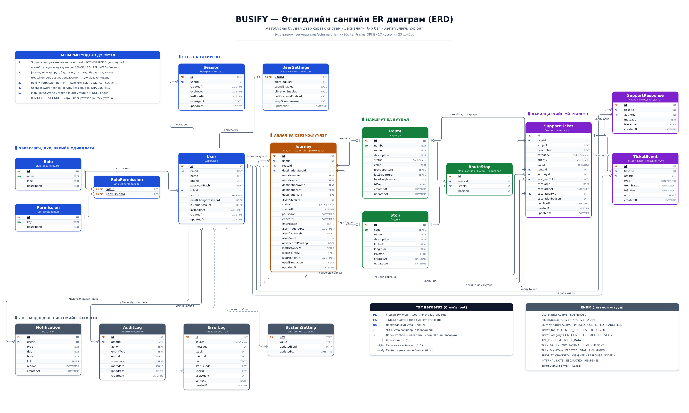

# BUSIFY database — ER diagram and table reference

BUSIFY stores everything in a single SQLite file managed by Prisma. The schema of
record is [`server/prisma/schema.prisma`](../server/prisma/schema.prisma); this page
is the picture of it.



*The labels on the diagram are Mongolian, to match the team's system-analysis documents
(`Use case`, `Activity` and `ER` diagrams). Table and column names are the real ones from
the schema. Open [`diagrams/busify-erd.svg`](diagrams/busify-erd.svg) for a crisp,
zoomable version.*

## Reading the diagram

| Mark | Meaning |
|---|---|
| **PK** | Primary key (also underlined and bold) |
| **FK** | Foreign key |
| **UQ** | Unique constraint |
| `?` after the type | The column is nullable |
| `~` | Logical reference only — **no** foreign key in the database (drawn dashed) |
| ─┤ | Exactly one row (1) |
| ─○┤ | Zero or one row (0..1) |
| ─○< | Zero or more rows (0..N) |

Entities are coloured by module: blue = users/roles/permissions, amber = journeys,
green = routes and stops, purple = customer support, slate = operational tables.

## Tables

### Users, roles and permissions

| Table | What it holds |
|---|---|
| `Role` | The three roles — `PASSENGER`, `SUPPORT`, `ADMIN` — with a display label. |
| `Permission` | One row per permission key (`journeys:use`, `routes:manage`, …). See [API.md](API.md#permissions). |
| `RolePermission` | Resolves the many-to-many between `Role` and `Permission`; its primary key is the pair of foreign keys. |
| `User` | Account, `bcrypt` password hash and role. `status` suspends an account; `isDemoAccount` marks seeded demo users. |
| `Session` | One row per signed-in browser. `id` is the **SHA-256 hash** of the token in the `busify_session` cookie, never the token itself. |
| `UserSettings` | One row per user (shared primary key): alert radius, sound, vibration, notifications, keep-screen-awake. |

### Routes and stops

| Table | What it holds |
|---|---|
| `Route` | Bus line: number, name, status, map colour and the optional schedule (`firstDeparture`, `lastDeparture`, `headwayMinutes`). |
| `Stop` | A stop with its `latitude`/`longitude`. |
| `RouteStop` | Ordered membership of a stop on a route. `position` is 1-based and unique per route, and a stop may appear on a route only once. |

### Journeys

| Table | What it holds |
|---|---|
| `Journey` | A passenger's alert session: the chosen route and destination stop, the alert radius, the live tracking state (`lastDistanceM`, `lastPositionAt`, `alertTriggeredAt`) and how it ended. |

### Customer support

| Table | What it holds |
|---|---|
| `SupportTicket` | A complaint, question or piece of feedback, optionally tied to the route or journey it is about. Carries the assignee and the escalation fields. |
| `SupportResponse` | A reply on a ticket. `isInternal` marks a note that passengers never see. |
| `TicketEvent` | The ticket timeline — created, reassigned, status changed, escalated, reopened. |

### Operations

| Table | What it holds |
|---|---|
| `Notification` | In-app notification for one user, with an optional `link` to open. |
| `AuditLog` | Who did what (`route.create`, `user.role_change`, `ticket.escalate`, …), with the actor, target and a JSON payload. |
| `ErrorLog` | Server and browser errors. `userId` is stored for context but is **not** a foreign key, so purging users never deletes error history. |
| `SystemSetting` | Key/value settings with a JSON-encoded `value`. `updatedById` is likewise a plain column, not a foreign key. |

## Relationships

| Parent | Child | Cardinality | Delete rule |
|---|---|---|---|
| `Role` | `User` | 1 : N | restrict |
| `Role` | `RolePermission` | 1 : N | cascade |
| `Permission` | `RolePermission` | 1 : N | cascade |
| `User` | `Session` | 1 : N | cascade |
| `User` | `UserSettings` | 1 : 1 | cascade |
| `User` | `Journey` | 1 : N | cascade |
| `User` | `SupportTicket` (passenger) | 1 : N | cascade |
| `User` | `SupportTicket` (`assignedToId`) | 0..1 : N | set null |
| `User` | `SupportTicket` (`escalatedById`) | 0..1 : N | set null |
| `User` | `SupportResponse` (author) | 1 : N | cascade |
| `User` | `TicketEvent` (actor) | 0..1 : N | set null |
| `User` | `AuditLog` (actor) | 0..1 : N | set null |
| `User` | `Notification` | 1 : N | cascade |
| `Route` | `RouteStop` | 1 : N | cascade |
| `Stop` | `RouteStop` | 1 : N | cascade |
| `Route` | `Journey` | 0..1 : N | set null |
| `Stop` | `Journey` (destination) | 0..1 : N | set null |
| `Route` | `SupportTicket` | 0..1 : N | set null |
| `Journey` | `SupportTicket` | 0..1 : N | set null |
| `SupportTicket` | `SupportResponse` | 1 : N | cascade |
| `SupportTicket` | `TicketEvent` | 1 : N | cascade |

## Design notes

1. **One open journey per passenger.** A passenger has at most one journey in
   `ACTIVE` or `PAUSED` state. Starting a new one cancels the previous with
   `endReason = 'REPLACED'`. This is enforced in `server/src/routes/journeys.ts`,
   not by a database constraint, so that journey history stays intact.
2. **Journeys snapshot their route and stop.** `routeNumber`, `routeName`,
   `destinationName`, `destinationLat` and `destinationLng` are copied when the journey
   starts. An administrator renaming a route or moving a stop afterwards does not
   rewrite past trips, and `routeId`/`destinationStopId` simply become `NULL` if the
   route or stop is deleted.
3. **Credentials are never stored in the clear.** `User.passwordHash` is a bcrypt hash
   and `Session.id` is a SHA-256 hash of the cookie token.
4. **Permissions live in the database.** Authorisation reads `RolePermission`, so a role
   sent by a client is ignored.

## Regenerating the diagram

The picture is generated from an explicit layout, so it is reproducible:

```bash
python3 docs/diagrams/generate-erd.py > docs/diagrams/busify-erd.svg
```

To refresh the PNG as well (Chromium is used only as the SVG renderer):

```bash
node -e "const{chromium}=require('playwright');(async()=>{const b=await chromium.launch();const p=await b.newPage({viewport:{width:2700,height:1620},deviceScaleFactor:1.5});await p.goto('file://'+process.cwd()+'/docs/diagrams/busify-erd.svg');await p.screenshot({path:'docs/diagrams/busify-erd.png'});await b.close();})()"
```

[`docs/diagrams/busify-erd.mmd`](diagrams/busify-erd.mmd) carries the same model as a
Mermaid `erDiagram`, for places that render Mermaid (GitHub, VS Code, Markdown previews).

When the schema changes, update `schema.prisma` first, record a migration with
`npm run db:migrate:dev -w server`, then update `generate-erd.py` and this page.
